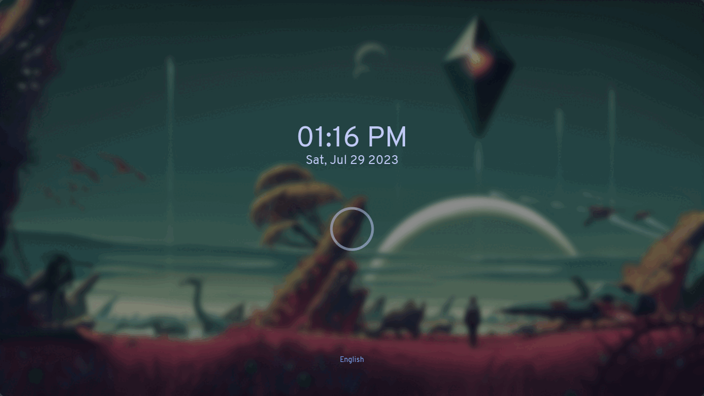
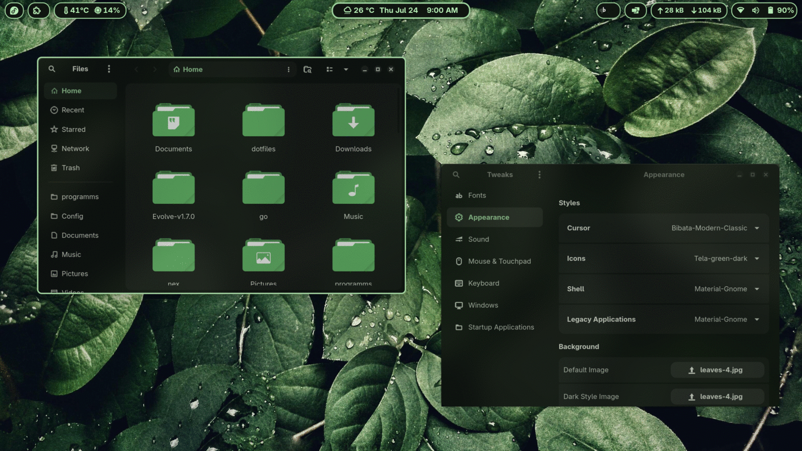
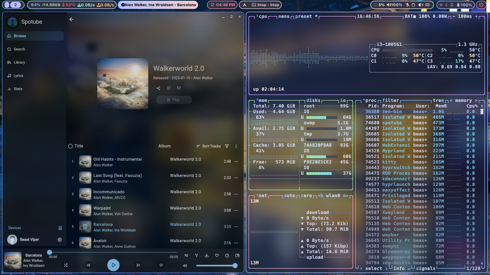

## whoami

Hristo

nerd

volunteer

member of snugbg.org


---

## What is ricing?

Gather around kids, it time for a story

---

## How do we rice ?

- raw - 🧙‍♂️style
- compile a list of instructions
- copy your files around
- symlink via something like gnu stow
- use proper tool like nix

---

### Issues with classic ricing #1

- How do you make sure the software is installed?

- you wont forget to install Vim - but you might forget things like - livedown, the silver searcher, etc

- you wont forget tmux - but did you remember to install wl-clipboard?

---

### Issues with classic ricing #2

- which version is the config file for?

- software is changing, so is its config

- bind software version to its config

- test before you flip the switch

---

### Issues with classic ricing #3

- Managing variations of config

- How do you manage templating?

- Slightly different config for different OSs/hosts

---

### Issues with classic ricing #4

- How do you manage secrets?

- Where is the API key for that MCP server?

- Can I treat my e-mail password as portable configuration for my e-mail client?

---

### Issues with classic ricing #5

How do you apply the setup on a new fresh system?

please dont say bash!

---

### Issues with classic ricing #6

How do you share your config with friends

---


## Intro to nix

- nix profile add
- flakes
- flake anatomy

```sh
cd src/01-anatomy-of-a-flake/
nix run . -- "hey, OpenFest"
```

::: notes
nix-channel --add https://nixos.org/channels/nixos-26.05 nixpkgs
nix-channel --update
nix-shell -p git
:::

---

## home-manager

lets rice gnome-terminal on Debian

```sh
cd src/02-1-ricing-gnome-terminal
nix run . -- switch --flake .#default --impure
```

::: notes
nix flake show --impure

# pre-build the flake
nix build --impure .#homeConfigurations.default.activationPackage
# or
nix run . -- build --flake .#default --impure
:::

---

### home-manager + our first module

lets rice tmux

```sh
cd src/02-2-ricing-tmux/
nix run . -- switch --flake .#default --impure
```

---

### home-manager + osx

- lets rice tmux on osx
```sh
cd src/02-2-ricing-tmux/
nix run . -- switch --flake .#default --impure
```

- when the rice clashes with the base OS
```sh
cd src/02-3-tmux-remap-osx-shortcuts/
nix run . -- switch --flake .#default --impure
```

---

## home-manager vs system-manager vs nixConfiguration

lets configure not the just the home folder but the entire system

```sh
cd src/02-4-nix-darwin/
# on osx
sudo nix run . -- switch --flake .#default --impure

# on debian
nix run . -- switch --flake .#default --sudo --nix-option pure-eval false
```


::: notes
# pre-build
nix build --impure path:.#systemConfigs.default

# nixos
sudo env NIXOS_CONFIG=/absolute/path/to/configuration.nix \
  nix run .#nixos-rebuild -- switch --flake .#default --impure

# debian
sudo apt install dbus-user-session libpam-systemd polkitd \
  pipewire pipewire-pulse wireplumber network-manager \
  gnome-keyring libpam-gnome-keyring gvfs gvfs-backends udisks2
:::

---

## Some ricing ideas

---

## Miserable XFCE

[mehedirm6244/Miserable_Xfce](https://github.com/mehedirm6244/Miserable_Xfce/tree/Serenade)



---

## Material GNOME

[SakibShahariar/Material-Gnome](https://github.com/SakibShahariar/Material-Gnome)



---

## ViperDots

[Beast-Viper/ViperDots-Hyprland](https://github.com/Beast-Viper/ViperDots-Hyprland)



## Lets hack

pick one - [Hannaha Montana Linux](./src/03-hannah-montana/) or [Nixarchy](./src/03-nixarchy/)?

[github.com/gotha/2026-openfest-ricing-with-nix](https://github.com/gotha/2026-openfest-ricing-with-nix)

## Look at my dotfliles, they are amazing!

[github.com/gotha/dotfiles](github.com/gotha/dotfiles)

- referencing config from different hosts
- secrets management
- deploy-rs
    - bastion
    - pizzie
- nixos-generators
    - usb installer
    - qemu target

---

## Thank you!

[hgeorgiev.com](https://hgeorgiev.com/)

here's my number, so ...
